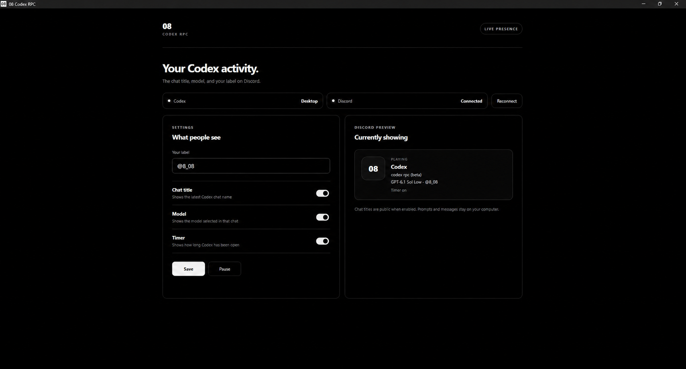
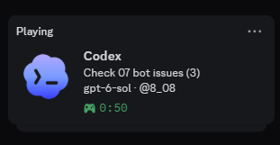

<div align="center">
  
  <h1>08 Codex RPC</h1>
  <p>Your Codex chat. Your model. Your Discord presence.</p>
  <p>A pure-black desktop companion by <a href="https://github.com/082-0">08</a>.</p>
  <p>
    <a href="https://github.com/082-0/08-codex-rpc/releases/latest">Download for Windows, macOS &amp; Linux</a>
    &nbsp;·&nbsp;
    <a href="#screenshots">Screenshots</a>
    &nbsp;·&nbsp;
    <a href="#build-from-source">Build from source</a>
    &nbsp;·&nbsp;
    <a href="https://github.com/082-0/08-codex-rpc/issues">Report an issue</a>
  </p>
</div>

## What it does

08 Codex RPC puts your latest local Codex chat title, selected model, reasoning level, and a custom user label on your Discord activity. Open the app while Discord desktop and Codex are running. No Developer Portal setup or bot token is needed.

- Live model and reasoning updates, such as `GPT-6 Sol High`.
- Chat title and editable user label.
- Separate switches for chat title, model, and elapsed time.
- Pause, resume, reconnect, and tray controls.
- Codex Desktop detection on Windows/macOS, and CLI detection on Windows/macOS/Linux.
- Black interface with a white-and-black 08 app icon.

The reader follows the latest updated local chat. It does not track which chat window has keyboard focus.

## Screenshots

### Dashboard

Captured from the running 1.0.2 app with Discord connected. Model names in screenshots reflect the selected model at capture time.



### Discord activity

An earlier live Discord card showing the chat title, model, and label. Version 1.0.2 also includes the reasoning level.



The dashboard's 08 card is a local preview. Discord uses the shared Codex application's title and artwork.

## Run it

1. Download the package for your system from [Releases](https://github.com/082-0/08-codex-rpc/releases/latest).
2. Keep the Discord **desktop app** open and signed in.
3. Open Codex, then launch 08 Codex RPC.
4. Set your label and choose which details to show. Click **Save**.

The app checks for activity about every 10 seconds. On Windows and macOS, closing its window keeps it in the system tray/menu bar. Use that menu to pause or quit. On Linux, closing the window quits the app so desktops without a tray do not leave an invisible process running.

| System | Package |
| --- | --- |
| Windows x64 | Portable `.exe` |
| macOS Apple silicon | `mac-arm64.dmg` or `.zip` |
| macOS Intel | `mac-x64.dmg` or `.zip` |
| Linux x64 | `linux-x86_64.AppImage` or `linux-x64.tar.gz` |
| Linux ARM64 | `linux-arm64.AppImage` or `.tar.gz` |

On macOS, open the DMG and drag the app into Applications, or extract the ZIP. Mac packages are ad-hoc signed and are not Apple-notarized. On Linux, mark the AppImage executable before opening it; the tar archive is available for systems without AppImage/FUSE support. Keep the Linux window open while sharing activity. Native Discord installations are preferred; sandboxed installations can restrict socket access.

Each platform is built and tested on its native GitHub Actions runner. Interactive Discord presence has been verified on Windows; macOS/Linux interactive Discord sessions have not yet been checked.

Enable activity sharing in Discord's Activity Privacy settings if your card is hidden. Only one RPC instance can run at a time; quit an older copy from its tray menu before opening an update.

## Privacy and local data

Chat titles and the enabled model, reasoning level, label, and timer are sent to your local Discord client for display on your profile. Disable **Chat title** or pause presence before working on a chat whose name you want to keep private.

The app reads Codex's local session index and, when available, the thread metadata database. Its fallback reads the tail of a session log to extract model and reasoning metadata; that log can contain message content, but prompts and messages are not included in the Discord activity. The app does not collect account credentials or send analytics.

Settings stay in Electron's per-user app-data directory: `%APPDATA%/eight-codex-rpc` on Windows, `~/Library/Application Support/eight-codex-rpc` on macOS, and `$XDG_CONFIG_HOME/eight-codex-rpc` (normally `~/.config/eight-codex-rpc`) on Linux. Codex metadata is read from `CODEX_HOME`, when set, or your home `.codex` folder. Codex's internal file format may change between versions.

## Build from source

Use Node.js 22.13 or later (with `node:sqlite` support). Build packages on their target operating system.

```sh
git clone https://github.com/082-0/08-codex-rpc.git
cd 08-codex-rpc
npm ci
npm test
npm run build:win
```

The portable EXE is written to `dist/`. To run the desktop app from source, use `npm start`.

For macOS use `npm run build:mac`; for Linux use `npm run build:linux`. These build x64 and ARM64 packages. GitHub Actions also builds all supported packages when a version tag is pushed.

The project uses Electron, electron-builder, plain HTML/CSS/JavaScript, and a small Discord IPC client. It does not need a separate Discord bot process.

## Source map

| Path | Purpose |
| --- | --- |
| `src/main.js` | Desktop window, settings, tray, and presence updates |
| `src/session.js` | Codex chat, model, and reasoning metadata |
| `src/detect.js` | Codex process detection across platforms |
| `src/ipc.js` | Local Discord IPC connection |
| `src/ui.*` | Black dashboard and controls |
| `assets/` | White-and-black 08 icons |
| `scripts/generate-icon.ps1` | Rebuild the app icons on Windows |
| `test/` | Metadata, detection, and IPC regression tests |

See [CHANGELOG.md](CHANGELOG.md) for release notes.

## Credits and application identity

Created by **08 / [082-0](https://github.com/082-0)**. Discord: `082_0`.

Inspired by the feature idea in [inerthel-agi/codex-rpc](https://github.com/inerthel-agi/codex-rpc). This project uses its own implementation. The bundled Discord application ID is public metadata from the shared Codex presence application; it is not a token. That application's identity and artwork belong to their respective owner, and continued availability is outside this project's control.

This project is independent of OpenAI and Discord.
